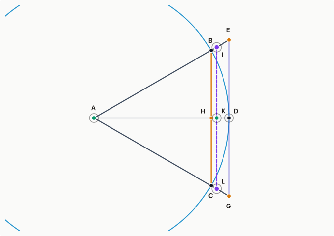

GEOMETOR • cusa
===============

**Visit the Online Archive:** https://geometor.github.io/cusa/

**Nicholas of Cusa • De Docta Ignorantia, De Mathematicis Complementis • semantic digital archive**

Mission
-------

``geometor/cusa`` is part of the interconnected `GEOMETOR <https://geometor.com>`_ semantic digital archive. It provides a synchronized four-track Latin-English Book Codex and exact symbolic geometry engine for the philosophical and mathematical treatises of Nicholas of Cusa (*Nicolaus Cusanus*). The archive liberates Cusa's groundbreaking investigations of the coincidence of opposites (*coincidentia oppositorum*), mathematical *transsumptio*, infinite circle-line transformations, and centerless cosmology from isolated print bounds into addressable semantic units, calibrated theme-adaptive vector diagrams, primary-source manuscript provenance, and exact symbolic geometry across the GEOMETOR corpus.

Books in This Archive
---------------------

- `On Learned Ignorance and Mathematical Writings <https://geometor.github.io/cusa/de_docta_ignorantia/>`_ — *De Docta Ignorantia* Book I (Chapters 1–23) and Book II (Chapters 11–12), developing the maximum and minimum, the coincidence of geometric figures, the infinite sphere, and centerless cosmology.
- `On Mathematical Complements <https://geometor.github.io/cusa/de_mathematicis_complementis/>`_ — *De Mathematicis Complementis* and *Scripta Mathematica* (1445–1459), including *On Geometric Transmutations*, *On Mathematical Complements*, *On Mathematical Perfection*, and *The Golden Proposition*.

Python Package & Modules
------------------------

The ``geometor-cusa`` Python package (``import geometor.cusa``) provides the executable symbolic geometry, construction, and compilation modules powering this archive:

- ``apparatus.py`` — Scholarly apparatus registries (glossary, persons, bibliography) for *geometor-cusa*.
- ``coincidentia_circle_line.py`` — Exact symbolic constructions and proofs for *De Docta Ignorantia* I.13 (Circle & Straight Line).
- ``coincidentia_triangle_line.py`` — Exact Rational Trigonometry constructions & proofs for *De Docta Ignorantia* I.14–15.
- ``commentary.py`` — Scholarly structural summaries and critical notes for the canonical units of GEOMETOR • cusa.
- ``compile_codex.py`` — Codex compiler generating the 4-track synchronized Book Codex and source manifests for Cusa.
- ``concordance.py`` — Cross-corpus concordance linking Nicholas of Cusa to the GEOMETOR canon.
- ``polygon_exhaustion_and_complementa.py`` — Exact symbolic constructions for Polygon Exhaustion (I.3) and Cusa's *Scripta Mathematica* (1445–1459).
- ``render.py`` — Interactive ``.euclid-graphic`` SVG renderer for Nicholas of Cusa's geometric constructions.
- ``texts_u1_u3.py`` — Primary Latin witnesses and original GEOMETOR English translations for Units I–III.
- ``texts_u4.py`` — Primary Latin witnesses and original GEOMETOR English translations for Unit IV (DI I.16–23).
- *Plus 4 additional modules under* ``src/geometor/cusa/``.

See the `API Reference <https://geometor.github.io/cusa/modules/>`_ for full module documentation.

Repository Contents
-------------------

- ``docsrc/`` — Four-track Book Codex, apparatus, and Sphinx documentation compiled by `PHOTON publish <https://github.com/photon-platform/publish>`_.
- ``resources/`` — Collated Latin sources, witness manifests, apparatus datasets (persons, citations, glossary), and cross-corpus concordances.
- ``src/geometor/cusa/`` — Python modules for exact symbolic circle-line coincidence, Rational Trigonometry models, polygon exhaustion, and diagram generation.

Local Build & Verification
--------------------------

.. code-block:: bash

   publish build
   uv run --no-sync pytest

Part of the GEOMETOR Knowledge Archive
--------------------------------------

Explore all **74 Book Codices** and **11 Mathematical Catalogs** at https://geometor.com/books/.
