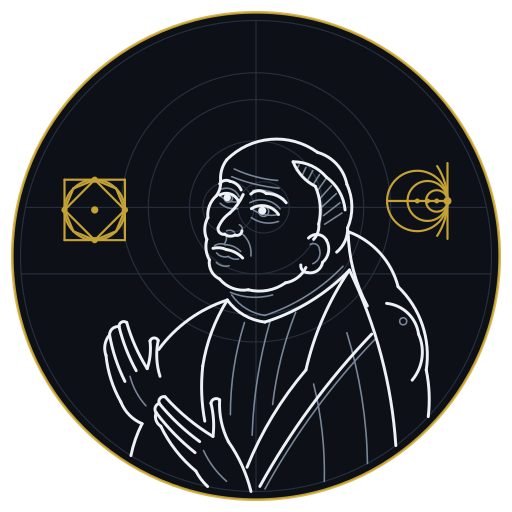

:site_title: Nicholas of Cusa

.. container:: author-overline

   semantic digital archive • the works of

================
Nicholas of Cusa
================

:person:`Nicholas of Cusa <cusanus>` (1401–1464) stood at the threshold between medieval Scholasticism and modern projective geometry—discovering in the asymptotic limit of an infinite circle the *coincidence of opposites* (*coincidentia oppositorum*), where curved and straight become one and the cosmos loses any privileged center. This synchronized four-track Latin–English archive pairs his philosophical masterpiece *De Docta Ignorantia* (1440) with four constructive mathematical treatises (*Scripta Mathematica*, 1445–1459) and exact symbolic reconstructions.

Books in This Collection
------------------------

.. container:: home-book-hero

   .. container:: home-book-thumb

      .. image:: _static/figures/cusa_circle_line_pencil.svg
         :alt: Tangent Circle Pencil and Coincidence of Line and Infinite Circle in Cusa's De Docta Ignorantia
         :target: de_docta_ignorantia/index.html

   .. container:: home-book-body

      .. rubric:: Primary Edition · 1440 · Books I & II · 4 Tracks

      **On Learned Ignorance & Mathematical Writings (De Docta Ignorantia)** — Cusa's landmark treatise completed at Kues on February 12, 1440: Book I (`Ch. 1–4, 11–23`) ascends from finite *ratio* to the infinite maximum where line, triangle, circle, and sphere coincide; Book II (`Ch. 11–12`) unfolds a centerless cosmos whose center is everywhere and circumference nowhere.

      .. container:: home-actions

         * :doc:`Open De Docta Ignorantia → <de_docta_ignorantia/index>`
         * :doc:`Infinite Line & Circle (I.13) → <de_docta_ignorantia/liber_i/cap_13/index>`
         * :doc:`Centerless Cosmos (II.12) → <de_docta_ignorantia/liber_ii/cap_12/index>`

.. container:: home-book-hero

   .. container:: home-book-thumb

      .. image:: _static/figures/cusa_aurea_propositio_1459.svg
         :alt: The Golden Proposition of 1459 in Cusa's Scripta Mathematica
         :target: de_mathematicis_complementis/index.html

   .. container:: home-book-body

      .. rubric:: Mathematical Opuscula · 1445–1459 · 4 Treatises · 4 Tracks

      **De Mathematicis Complementis (Scripta Mathematica)** — Cusa's four constructive treatises on geometric transmutation and circle rectification: *De Geometricis Transmutationibus* (1445), *De Mathematicis Complementis* (1453), *De Mathematica Perfectione* (1458), and *Aurea Propositio in Mathematicis* (1459).

      .. container:: home-actions

         * :doc:`Open Mathematical Complements → <de_mathematicis_complementis/index>`
         * :doc:`Geometric Transmutations (1445) → <de_mathematicis_complementis/transmutatio_1445/index>`
         * :doc:`The Golden Proposition (1459) → <de_mathematicis_complementis/aurea_propositio_1459/index>`

Key Features
------------

.. container:: home-feature-grid

   .. container:: home-feature-card

      **Four Synchronized Codex Tracks**

      Every chapter pairs collated Latin (1440 / 1514–1913 witnesses) with an original English translation, structural summary, and geometric-theological notes.

   .. container:: home-feature-card

      **Nine Calibrated Vector Plates & SymPy Proofs**

      Explore theme-adaptive SVG figures of Cusa's circle-line coincidence, Möbius inversion, polygon exhaustion, and three-ray rectification alongside exact algebraic proofs in :doc:`Demos <demos/index>`.

   .. container:: home-feature-card

      **Cross-Corpus Concordance & Lexicon**

      Trace **15 canonical Cusan loci** to Plato, Aristotle, Euclid, Archimedes, Proclus, Aquinas, Kepler, and Klein in the :doc:`Concordance <concordance>`, supported by **26 technical terms** in the :doc:`Glossary <glossary>`.

Reference & Project
-------------------

.. container:: home-columns

   .. container:: home-col

      .. rubric:: Scholarly Apparatus

      * :doc:`Concordance <concordance>` — 15 Cusan loci linked across the classical and modern GEOMETOR canon
      * :doc:`Glossary <glossary>` — 26 Latin, Greek, and constructive Cusan concepts
      * :doc:`People <people/index>` & :doc:`Bibliography <bibliography>` — Biographical profiles and 28 primary/secondary editions

   .. container:: home-col

      .. rubric:: About This Project

      * :doc:`About <about/index>` & :doc:`Editions & Sources <about/editions-and-sources>` — Editorial scope and textual provenance
      * :doc:`Using This Edition <usage/index>` & :doc:`Symbolic Demos <demos/index>` — Codex navigation and exact SymPy constructions in ``geometor.cusa``
      * :doc:`Log <log/index>` & :doc:`Modules <modules/index>` — Development notes and Python API documentation

.. toctree::
   :maxdepth: 2
   :hidden:

   de_docta_ignorantia/index
   de_mathematicis_complementis/index
   people/index
   bibliography
   glossary
   concordance
   about/index
   usage/index
   demos/index
   log/index
   modules/index
